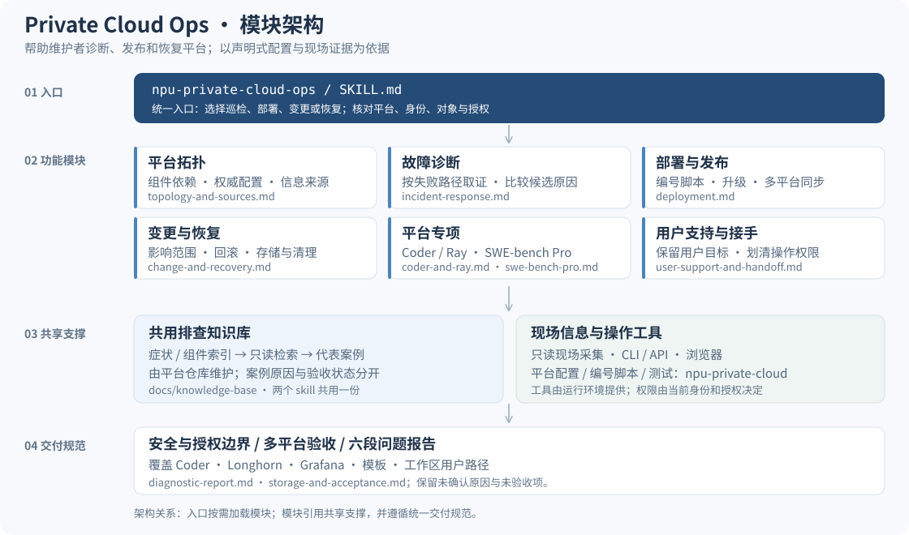

# NPU Private Cloud Operations Skill

给平台维护者和获授权 AI 助手使用的 Ascend NPU 私有云运维 Skill。覆盖 Coder、Kubernetes、Volcano、
Longhorn、KubeRay、Ray Dashboard、Prometheus、Grafana、zot 和 nginx 网关。

平台实现、安装脚本和验收测试位于：
[`yancanmao/npu-private-cloud`](https://github.com/yancanmao/npu-private-cloud)。

普通用户的组件百科、登录、工作区、SSH、面板和已发布应用部署使用该仓库中的
[`coder-platform-user`](https://github.com/yancanmao/npu-private-cloud/tree/main/skills/coder-platform-user)。
本 ops skill 保留管理员巡检、发布、恢复和策略维护；普通用户无需交出管理员凭据。

## 模块架构



入口按任务加载六个功能模块，模块共用排查知识库和现有运维工具；
安全边界、问题报告与多平台验收贯穿全部模块。箭头表示依赖，不要求每次运行全套流程。

案例正文只在 [平台知识库](https://github.com/yancanmao/npu-private-cloud/tree/main/docs/knowledge-base) 维护，
本 skill 通过 `references/knowledge-base.md` 访问；
[普通用户 skill 架构](https://github.com/yancanmao/npu-private-cloud#ai-助手与共享排查知识库) 采用同样的分层方式，操作权限不同。

## 安装

### Codex

```bash
git clone https://github.com/yancanmao/npu-private-cloud-ops-skill.git \
  ~/.codex/skills/npu-private-cloud-ops
```

### Claude Code

```bash
git clone https://github.com/yancanmao/npu-private-cloud-ops-skill.git \
  ~/.claude/skills/npu-private-cloud-ops
```

重启对应客户端后，可以直接说：

```text
使用 npu-private-cloud-ops 检查为什么 Coder 工作区一直 Connecting。
```

### 安装共享案例库（排查功能必需）

上面的克隆只安装 skill 本体，**不会自动安装共享案例库**。还需要有权访问平台仓库的本地
checkout；已克隆则复用，不重复创建。平台仓库访问权限与集群管理员权限是两回事，
不要向用户索取管理员凭据。无法取得知识包时应明确说明未安装，不能宣称已完成案例检索。

在平台仓库根目录执行，将 `<OPS_SKILL_DIR>` 替换为上面实际克隆的路径：

```bash
python3 scripts/install_knowledge_base.py --skill-dir "<OPS_SKILL_DIR>"
python3 scripts/install_knowledge_base.py --skill-dir "<OPS_SKILL_DIR>" --apply
python3 "<OPS_SKILL_DIR>/references/knowledge-base/tools/search.py" --validate
python3 "<OPS_SKILL_DIR>/references/knowledge-base/tools/search.py" 'Connecting' --audience ops
```

同时安装用户 skill 时，对同一次安装追加 `--skill-dir "<USER_SKILL_DIR>"`，两者链接到同一个
经过 SHA256 校验的知识包。更新知识包后也重跑安装器；不要携带另一台机器的绝对链接。
目录对应关系与可重复检查见 [架构对账](https://github.com/yancanmao/npu-private-cloud/blob/main/docs/skill-architecture.md)。

## 人工使用

遇到故障先在控制节点运行只读现场采集：

```bash
bash scripts/collect-platform-snapshot.sh
```

生成的目录可能包含内部地址和工作区名称，不要提交到 GitHub。把它私下交给维护者分析。

## 内容

- `SKILL.md`：操作边界、诊断顺序和验收原则。
- `references/deployment.md`：从零部署与升级入口。
- 同一手册还覆盖逐集群发布、闲置回收与 admin 豁免、原生 TTL、vLLM 自动发现和 Grafana 数据验收；不把单集群或面板加载成功当成全平台验收。
- `references/topology-and-sources.md`：组件拓扑、服务位置和权威配置。
- `references/incident-response.md`：按症状定位故障。
- `references/diagnostic-report.md`：问题定位报告、证据与因果分析、修复验收和短版汇报规范；默认直接在聊天输出。
- `references/user-support-and-handoff.md`：用户支持、权限边界和管理员接手；避免把普通用户请求自动升级成平台变更。
- `references/knowledge-base.md`：共享分类索引、代表案例与本地只读检索；正文仅在平台仓库维护。
- `references/coder-and-ray.md`：Coder、KubeRay、Ray Dashboard 专项手册。
- `references/change-and-recovery.md`：安全变更、回滚和清理。
- `scripts/collect-platform-snapshot.sh`：只读证据采集脚本。

## 安全原则

仓库不保存真实 IP、域名、主机名、账号、密码、令牌或私钥。删除数据、停止别人的工作区、
修改共享平台或释放资源前，必须得到明确授权并保存现场。

Apache-2.0 License。
